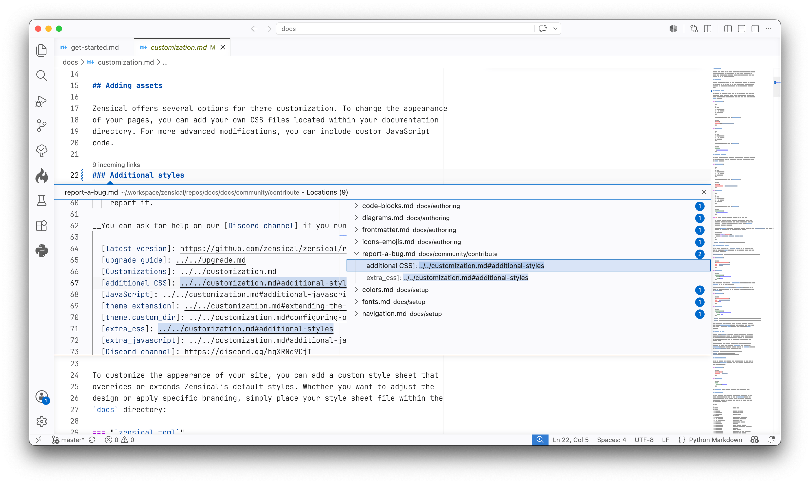

  <picture>
    <source media="(prefers-color-scheme: dark)" srcset="https://raw.githubusercontent.com/zensical/studio/master/.github/assets/studio-dark.png">
    <source media="(prefers-color-scheme: light)" srcset="https://raw.githubusercontent.com/zensical/studio/master/.github/assets/studio.png">
    
  </picture>

<h3 align="center">
  <strong>Refactor documentation like code</strong>
</h3>

  <a href="https://zensical.org/studio/"><strong>Home</strong></a>
  &middot;
  <a href="https://zensical.org/docs/studio/get-started/"><strong>Get started</strong></a>
  &middot;
  <a href="https://zensical.org/roadmap/"><strong>Roadmap</strong></a>
  &middot;
  <a href="https://zensical.org/about/newsletter/"><strong>Newsletter</strong></a>

  Catch broken links instantly. Zensical Studio keeps links, headings, and references up to date when you rename, move, or restructure content. Blazing fast and reliable, integrated with your editor.

  Works with all <a href="https://zensical.org/">Zensical</a> and MkDocs projects.

  <picture>
    <source media="(prefers-color-scheme: dark)" srcset="https://raw.githubusercontent.com/zensical/studio/master/.github/assets/screenshot-dark.png">
    <source media="(prefers-color-scheme: light)" srcset="https://raw.githubusercontent.com/zensical/studio/master/.github/assets/screenshot.png">
    
  </picture>

  <em>
    Zensical Studio in Visual Studio Code. Learn more at
    <a href="https://zensical.org/studio/">zensical.org/studio/</a>.
  </em>

Studio comes in three editions:

- **Studio Free** supports everyday authoring, preview, and diagnostics. It is
  free to use and does not require an account or subscription.
- **Studio Pro** adds project-wide refactoring, including automatic link updates
  when you move or rename content.
- **Studio Team** includes Studio Pro features with organization-owned,
  reassignable seats.

[Compare features](https://zensical.org/studio/features/) or
[view pricing](https://hub.zensical.org/pricing/studio). Subscriptions help
support Zensical and our other Open Source projects, and allow us to keep
Zensical [independent](https://zensical.org/about/sustainability/).

## Features

Studio understands your Zensical or MkDocs project and brings everyday authoring
tools into your editor. Features include:

- **Python Markdown editing:** accurate [syntax highlighting](https://zensical.org/docs/studio/write/highlighting/), including nested content.
- **Formatting and linting:** [format Markdown](https://zensical.org/docs/studio/write/formatting/) without reflowing your prose and [catch structural problems](https://zensical.org/docs/studio/write/linting/) as you write.
- **Link assistance:** complete links, preview their targets on hover, and [spot broken links and missing assets](https://zensical.org/docs/studio/workflows/link-intelligence/).
- **Project navigation:** [navigate your content](https://zensical.org/docs/studio/write/navigation/), search workspace symbols, and [find references](https://zensical.org/docs/studio/workflows/link-intelligence/) across your project.
- **Live preview:** [see your changes as you write](https://zensical.org/docs/studio/write/preview/), including reused content.

Studio Pro and Team add project-wide refactoring, automatic link updates when
you [move or rename files](https://zensical.org/docs/studio/write/moving-files/),
and [managed redirects](https://zensical.org/docs/setup/redirects/) that
preserve incoming links when content changes.
[See all features](https://zensical.org/studio/features/).

## Installation

Install [Zensical Studio in Visual Studio Code](https://marketplace.visualstudio.com/items?itemName=zensical.zensical-studio)
and open your Zensical or MkDocs project. Studio automatically detects
`zensical.toml` or `mkdocs.yml` and activates Python Markdown support for your
documentation files.

Studio Free works without signing in. To activate Studio Pro or Team, obtain
your license key in [Zensical Hub](https://hub.zensical.org/) and run
**Zensical Studio: Enter License Key** from the VS Code Command Palette.

For setup details and other editor integrations, see the
[installation guide](https://zensical.org/docs/studio/get-started/install/).

**Supported platforms**

- **Windows:** arm64, x64
- **macOS:** arm64, x64
- **Linux:** arm64, x64

## Support

If you think you've found a bug, or have ideas for improvements, please report
them in the [Zensical Studio GitHub repository](https://github.com/zensical/studio/issues).
With your feedback, we'll shape Zensical Studio into the authoring environment
technical writers and documentation teams want to use.

## License

This repository contains the editor integrations for Zensical Studio, which are
licensed under MIT. Zensical Studio is licensed separately under the
[EULA](https://zensical.org/studio/license/eula/). By using Zensical
Studio, you agree to the terms of the EULA.
